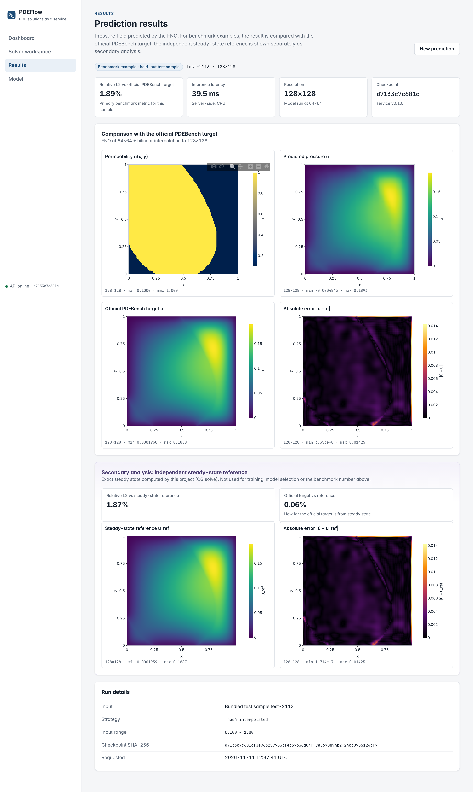

# PDEFlow: PDE Solutions as a Service using Fourier Neural Operators

## What it does

PDEFlow is a small "PDE solutions as a service" application for **2D steady Darcy flow**, the equation for pressure in
a porous medium:

  −∇·( a(x) ∇u(x) ) = 1  on the unit square,  u = 0 on the boundary.

You give it a **permeability field** a(x, y) on a 64×64 or 128×128 grid. A trained **Fourier Neural Operator (FNO)**
returns the **pressure field** u(x, y) in one forward pass, instead of running a numerical solver. You can:

- pick one of 24 held-out **PDEBench benchmark examples**, and see the prediction next to the official PDEBench solution
  with the error. An independent steady-state reference is shown **separately**, as secondary analysis.
- upload or generate a **custom field**. There is no ground truth for those, so no error is shown, and inputs unlike
  the training data are flagged.

The interfaces are a web app (Next.js + TypeScript + Plotly), a REST API (FastAPI), and a Gradio interface for the
Hugging Face ZeroGPU deployment.

## Results (1,000 held-out test samples; `reports/m2_eval_fno_baseline.json`)

| Setting | mean relative L2 vs **official PDEBench target** | median |
|---|---|---|
| 64×64 (training resolution) | 0.0293 | 0.0171 |
| 128×128, 64×64 inference + interpolation (the served default) | 0.0320 | 0.0205 |
| 128×128, direct (zero-shot) | 0.0421 | 0.0315 |

Errors are relative to the official PDEBench targets, on this project's split; they are **not directly comparable to
PDEBench's published numbers**. Latency depends on the host; we measured tens of milliseconds per request on the
4-vCPU machine we tested ([`docs/API.md`](docs/API.md), [`docs/DOCKER.md`](docs/DOCKER.md)).

## Limitations (details: [`docs/RESULTS.md`](docs/RESULTS.md) §6, [`docs/ZEROGPU.md`](docs/ZEROGPU.md) §5)

- **Training data:** trained only on PDEBench Darcy β = 1.0: binary permeability fields (0.1 / 1.0), unit square, zero boundary
  values. Other inputs are extrapolation (flagged by the API).
- **Training setup:** single training resolution (64×64), 2,000 training samples, 150 epochs, one seed; no variance across seeds.
- **Resolution transfer:** not resolution-invariant within its error level. Direct 128×128 inference is worse than 64×64 inference
  plus interpolation (which is why the latter is the default).
- **Hardest cases:** error varies widely across samples (worst test sample about 24%), and is largest for low-permeability fields and
  near the boundary.
- **Official targets:** some official PDEBench targets are not fully converged to steady state. The model reproduces the official
  targets, so its error against the exact steady state is higher (0.0391 vs 0.0293 mean at 64×64).

## Model and checkpoint provenance

- **Checkpoint:** `backend/models/fno_darcy_beta1_baseline.pt`, SHA-256
  `d7133c7c681cf3e9632579833fe357636d84ff7a5678d94b2f24c38955124df7`. It is pinned in code and verified at every startup.
- **Training:** produced in this repository by `scripts/train.py` with `backend/configs/fno_baseline.yaml`: neuraloperator 2.0.0 FNO
  (12×12 modes, width 32, 4 layers, 357,217 parameters), CPU, best validation epoch 139.
- **Records:** config, data hashes, logs and history are in `reports/m2_run_fno_baseline/`; see [`docs/TRAINING.md`](docs/TRAINING.md).

## Data attribution

PDEBench: Makoto Takamoto, Timothy Praditia, Raphael Leiteritz, Dan MacKinlay, Francesco Alesiani, Dirk Pflüger,
Mathias Niepert. *PDEBench: An Extensive Benchmark for Scientific Machine Learning.* NeurIPS 2022 Datasets and
Benchmarks Track. Data: *PDEBench Datasets*, DaRUS, [doi:10.18419/darus-2986](https://doi.org/10.18419/darus-2986),
licensed [CC BY 4.0](https://creativecommons.org/licenses/by/4.0/).
- **Bundled data:** only **24 test samples** (`backend/assets/demo_samples_v1.npz`); they stay CC BY 4.0.
- **Not redistributed:** the full 1.3 GB dataset (`scripts/download_pdebench.py` fetches it and checks its MD5).
- **Changes:** described in [`docs/DATA.md`](docs/DATA.md) and [`docs/PREPROCESSING.md`](docs/PREPROCESSING.md).

## Status

**Live: https://pdeaas.onrender.com** (Render Free; Docker image built from this repository).

Verified on 2026-11-12 at 06:02 and 10:48 UTC:
- **API:** health with the pinned checkpoint SHA, the model card and the samples all match the local API.
- **Predictions:** real predictions match the validated local pipeline within 4.2 × 10⁻⁷.
- **Browser tests:** 26/26 Playwright tests pass against the public URL.

**Free-tier caveats:**
- The service **sleeps after 15 minutes idle**. One observed wake-up did **not** complete within 30 minutes, so the
  first visit after a quiet period may be slow or fail; retry after a few minutes.
- 512 MB RAM, < 1 CPU, CPU-only inference.

Details, evidence and the earlier Hugging Face attempts are in [`docs/HOSTING.md`](docs/HOSTING.md).

| Document | Contents |
|---|---|
| [`docs/PLAN.md`](docs/PLAN.md) | architecture, decision log, risks, milestones |
| [`docs/BLOCKERS.md`](docs/BLOCKERS.md) | environment/network assessment, measured CPU cost, schedule |
| [`docs/DATA.md`](docs/DATA.md) | dataset provenance, structure, physics verification, the two targets, data findings |
| [`docs/TRAINING.md`](docs/TRAINING.md) | model/training decisions, checkpoint format, run log notes |
| [`docs/RESULTS.md`](docs/RESULTS.md) | baseline test results (64² and 128²; official vs reference), latency, limitations |
| [`docs/API.md`](docs/API.md) | API endpoints, validation, logging, model-identity checks, latency |
| [`docs/FRONTEND.md`](docs/FRONTEND.md) | frontend architecture, pages, scientific presentation rules, tests, screenshots |
| [`docs/HOSTING.md`](docs/HOSTING.md) | live Render deployment, verification results, sleep/cold-start observations, free-tier and CPU-inference limits, earlier HF attempts |
| [`docs/ZEROGPU.md`](docs/ZEROGPU.md) | ZeroGPU Gradio Space: architecture, compatibility decisions, validation, hosting risks |
| [`docs/FREE_HOSTING_FEASIBILITY.md`](docs/FREE_HOSTING_FEASIBILITY.md) | zero-cost hosting comparison (HF ZeroGPU vs Render Free), measured |
| [`docs/DOCKER.md`](docs/DOCKER.md) | Docker image design, build/run, container test results and resource usage |
| [`docs/DEPLOYMENT.md`](docs/DEPLOYMENT.md) | Hugging Face Docker Space configuration, secrets, deployment command (not deployed yet) |
| [`docs/PREPROCESSING.md`](docs/PREPROCESSING.md) | splits, normalisation, 128→64 downsampling validation, evaluation plan |
| [`docs/M1_AUDIT_REPORT.md`](docs/M1_AUDIT_REPORT.md) | M1 scientific audit + reproducibility report |
| [`CHECKLIST.md`](CHECKLIST.md) | progress |

## Run the application locally

Requires the Python environment below (`.venv`) and Node 22. No dataset is needed: the API serves the committed checkpoint
(SHA-256 pinned) and 24 bundled held-out test samples.

```bash
.venv/bin/uvicorn pdeflow.api.app:app --app-dir backend --host 127.0.0.1 --port 8000
```

```bash
cd frontend && npm ci && npm run build
PORT=3000 PDEFLOW_API_URL=http://127.0.0.1:8000 node .next/standalone/server.js   # open http://localhost:3000
```



Tests: `cd backend && ../.venv/bin/python -m pytest` (backend); `cd frontend && npm test && npm run e2e` (frontend; see docs/FRONTEND.md).

## Run with Docker (single container, as deployed)

```bash
docker build -t pdeflow .
docker run --rm -p 7860:7860 pdeflow        # http://localhost:7860
```

Or use `docker compose up --build`. The image contains the Next.js frontend (public, port 7860) and the FastAPI backend
(internal, 127.0.0.1:8000). It also bundles the checkpoint (SHA-256 verified at build and at startup) and the 24 attributed
demo samples. It contains no dataset and no credentials. It runs as UID 1000, with a health check and graceful
shutdown. Details and measured resource usage are in [`docs/DOCKER.md`](docs/DOCKER.md).

## Run as the ZeroGPU Space app (Python 3.12, local)

```bash
uv venv --python 3.12.12 .venv-zerogpu && uv pip install --python .venv-zerogpu/bin/python --no-deps -r deploy/zerogpu/requirements-dev.txt
.venv/bin/python deploy/zerogpu/build_frontend.py
PORT=7860 .venv-zerogpu/bin/python deploy/zerogpu/app.py      # /  (web app)  /gradio  /api/docs
```

## Deploy to Hugging Face Spaces (ZeroGPU Gradio Space; attempted twice, not live: see docs/HOSTING.md)

Authentication uses the sandbox proxy's host-scoped secret for `huggingface.co`, so no token is read, stored or
printed. The owner creates the empty Space on the website, and the script never creates one. It runs a read-only
preflight (owner, Gradio SDK, public, ZeroGPU) before any upload ([`docs/ZEROGPU.md`](docs/ZEROGPU.md) §6).

```bash
.venv/bin/python deploy/zerogpu/build_frontend.py
.venv/bin/python scripts/deploy_zerogpu_space.py --space bavi404/pdeflow --dry-run
uv run --no-project --python 3.11 --with huggingface_hub==2.2.0 python scripts/deploy_zerogpu_space.py --space bavi404/pdeflow --preflight-only
# only with the owner's explicit approval:
uv run --no-project --python 3.11 --with huggingface_hub==2.2.0 python scripts/deploy_zerogpu_space.py --space bavi404/pdeflow --confirm-deploy bavi404/pdeflow --wait 2400
```

A Docker Space (`scripts/deploy_hf_space.py`, [`docs/DEPLOYMENT.md`](docs/DEPLOYMENT.md)) would need a paid plan.

## Reproduce M1 (data pipeline)

```bash
uv venv --python 3.11 .venv
uv pip install --python .venv/bin/python \
  --index-url https://download.pytorch.org/whl/cpu --extra-index-url https://pypi.org/simple \
  --index-strategy unsafe-best-match -r backend/requirements.lock
uv pip install --python .venv/bin/python --no-deps -e backend
```

```bash
bash scripts/reproduce_m1.sh   # download+MD5, inspect, preprocess, downsampling validation, audit, solver verification, strict tests
```

The lock file pins the CPU-only torch wheel for Linux x86_64. On macOS, install `torch==2.15.0` from PyPI instead.

## Licence

- **This project:** the source code and trained checkpoint are released under the [MIT licence](LICENSE).
- **Bundled PDEBench samples:** **not** MIT; they remain [CC BY 4.0](https://creativecommons.org/licenses/by/4.0/) (see Data attribution above).
- **Third-party dependencies:** each keeps its own licence. The web frontend ships their licence texts as
`/third-party-licenses.txt`. The ZeroGPU Space installs NVIDIA's CUDA libraries under NVIDIA's terms. See [`NOTICE.md`](NOTICE.md).
