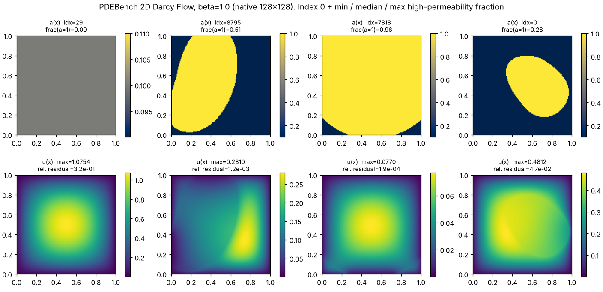
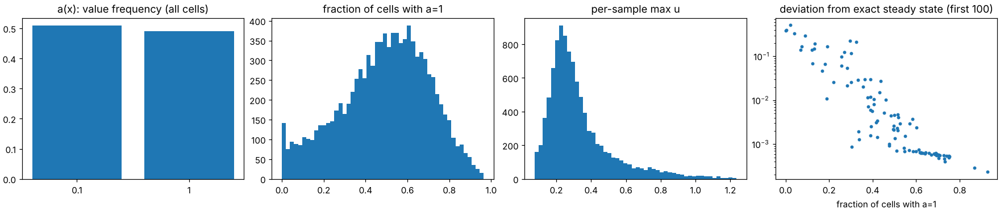
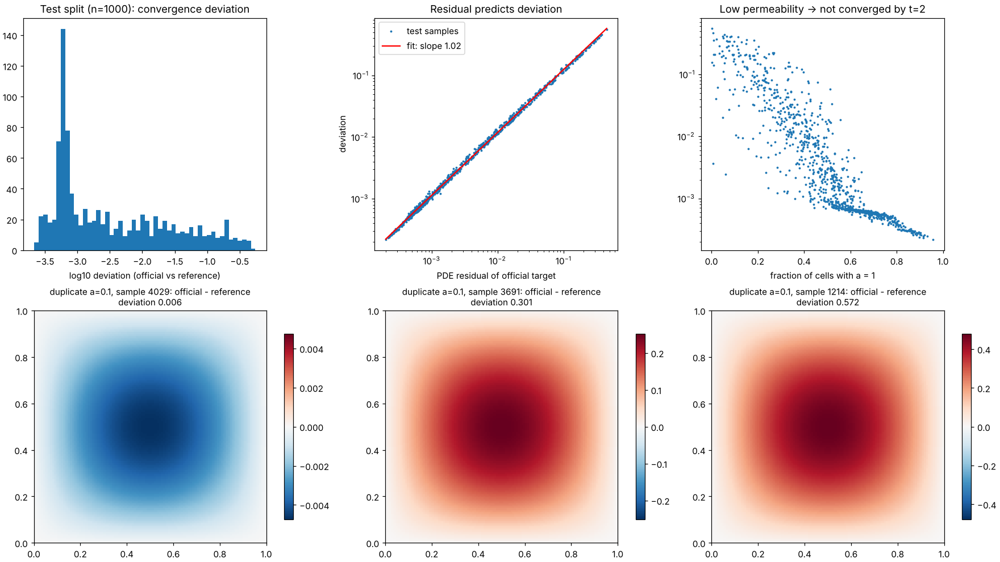

# Dataset: PDEBench 2D Darcy Flow, β = 1.0

Every number in this document is produced by a script in this repository from the real downloaded file. The
"Report" column of the traceability table (§8) gives the exact JSON file for each.
`backend/tests/test_docs_traceability.py` checks that the headline numbers here match those reports.

## 0. Two targets: never mixed

| | **Official PDEBench target** | **Independent steady-state reference** |
|---|---|---|
| What | `tensor` from the released HDF5, **unmodified** | Exact discrete steady state of −∇·(a∇u) = β, computed here by CG (§5) |
| Role | **Training target and primary benchmark.** The FNO learns to reproduce it; "test error" always means error against it. | **Secondary scientific analysis only**: interprets errors; quantifies the data's non-convergence |
| Where | `data/processed/darcy_beta1.0_{train,val,test}.npz`, key `u`, `target_source="official PDEBench tensor, unmodified"` | `data/processed/darcy_beta1.0_test_reference.npz`, key `u_reference`, `target_source="independent steady-state reference ..."` |
| Splits | train, val, test | **test only**: no reference exists for train/val |
| Metrics key | `primary_vs_official_pdebench_target` | `secondary_vs_independent_steady_state_reference` (`pdeflow/evaluation/metrics.py`) |
| Used for training / normalisation / early stopping / model selection | yes (train/val) | **never** (guard test `test_reference_isolation.py`; verification §5, check 8) |

## 1. Provenance

| Field | Value |
|---|---|
| Dataset | PDEBench (Takamoto et al., NeurIPS 2022 Datasets & Benchmarks), DaRUS `doi:10.18419/darus-2986` |
| File | `2D/DarcyFlow/2D_DarcyFlow_beta1.0_Train.hdf5` |
| DaRUS file id / URL | 133219, `https://darus.uni-stuttgart.de/api/access/datafile/133219` (HTTP 303 → `s3.tik.uni-stuttgart.de`) |
| Size | 1,310,724,488 bytes |
| MD5 (live DaRUS listing) | `81694ed31306ff2e5f6b76349b0b4389` |
| MD5 (on disk, independent re-hash) | `81694ed31306ff2e5f6b76349b0b4389`: **match**; re-verified on every pipeline run |
| SHA-256 | in `data/raw/2D_DarcyFlow_beta1.0_Train.hdf5.provenance.json` |
| Retrieved | 2026-11-11 07:41–07:42 UTC, one full download, ≈ 16 MB/s (`logs/m1_download.jsonl`) |

The raw file is not committed (1.3 GB third-party data). `scripts/download_pdebench.py` reproduces it and aborts on
any size or MD5 mismatch.

## 2. Verified HDF5 structure

| Dataset | Shape | dtype | Meaning |
|---|---|---|---|
| `nu` | (10000, 128, 128) | float32 | permeability a(x): the **input** |
| `tensor` | (10000, 1, 128, 128) | float32 | u(x) at the final time t = 2 (one slice): the **official target** |
| `x-coordinate` | (128,) | float32 | 0.00390625 … 0.99609375, uniform spacing 0.0078125 |
| `y-coordinate` | (128,) | float32 | identical to x |
| root attr `beta` | scalar | float64 | 1.0 |

- **Samples:** 10,000. The grid is **cell-centred**: x_i = (i + ½)/128 = (2i+1)/256, dx = 1/128. Storage is contiguous and uncompressed.
- **Model tensors:** input `(B, 1, R, R)` ← `nu`; official target `(B, 1, R, R)` ← `tensor[:, 0]`. R = 128 native, 64 for training.

## 3. Value ranges (all 10,000 samples)

| Quantity | min | p1 | median | p99 | max | mean | std |
|---|---|---|---|---|---|---|---|
| a = `nu` | 0.1 | 0.1 | 0.1 | 1.0 | 1.0 | 0.5416 | 0.4499 |
| u = `tensor` | 1.78e-4 | 5.26e-3 | 0.1283 | 0.7023 | 1.2352 | 0.1617 | 0.1409 |
| per-sample max u | 0.0762 | 0.0910 | 0.2774 | 1.0236 | 1.2352 | 0.3316 | 0.1890 |
| fraction of cells with a = 1, per sample | 0.0 | 0.0104 | 0.5108 | 0.8972 | 0.9643 | 0.4906 | 0.2094 |
| u on the outermost ring of cells | 1.78e-4 | 1.12e-3 | 0.0122 | 0.0352 | 0.1298 | 0.0123 | 0.0079 |

- **a is exactly binary:** {0.1, 1.0} only (83,453,541 vs 80,386,459 cells).
- **u is strictly positive.** There are no NaN or Inf values.
- **Boundary values are non-zero.** u on the outer ring is about 1/10 of the interior maximum, because u = 0 is imposed
  half a cell *outside* [0,1] (§4).

## 4. Governing equation, forcing and boundary conditions

**Documented (PDEBench paper and README):** −∇·(a∇u) = f on (0,1)², u = 0 on the boundary, f ≡ β = 1.

**Generator code (read, not executed):** PDEBench commit `4ff3e3a`, `data_gen_NLE/ReactionDiffusionEq/reaction_diffusion_2D_multi_solution_Hydra.py`.
- **Time stepping:** it integrates the transient ∂u/∂t = ∇·(a∇u) + β up to t = 2, starting from a random field.
  The initial-condition amplitude parameter is drawn from U(0.1, 10) (`utils.py:186`).
- **Discretisation:** finite volumes on the cell-centred grid with arithmetic-mean face coefficients.
- **Permeability:** a = 1 where a sum of 5 random Gaussians exceeds its mean, otherwise 0.1.
- **Boundary:** the ghost values of u are set to 0. That is **zero Dirichlet** at the ghost-cell centres, even though
  the helper is called `mode="Neumann"`.

**Verified against the released data** (`reports/data_inspection.json`), using the residual r = β + ∇·(a∇u_official),
which equals du/dt at t = 2:

| Boundary-face permeability model | RMS residual, boundary ring | RMS residual, interior |
|---|---|---|
| zero ghost permeability (current public generator code) | 20.6 | 7.6e-2 |
| **boundary face a = adjacent cell's a (fitted; used here)** | **2.9e-3** | 7.6e-2 |

The two models differ only at the boundary, and the boundary residual separates them by about four orders of
magnitude. The released data obeys the fitted convention. This differs slightly from the current public code; we use what the
data actually satisfies. The interior residual is not zero because some samples are not converged (§6).

## 5. The independent steady-state reference solver (verified)

`pdeflow/data/physics.py`; verification by `scripts/verify_reference_solver.py` → `reports/reference_solver_verification.json`.

| Item | Configuration |
|---|---|
| Operator | A u = −∇·(a∇u): 5-point finite-volume stencil, arithmetic face means (same as generator) |
| Boundary | u ghost = 0 (zero Dirichlet at ghost centres, effective domain side 1 + dx); boundary face a = adjacent cell a |
| Method | conjugate gradient, unpreconditioned, batched; float64; zero initial guess |
| Stopping rule | **true** residual ‖b − Ax‖₂ ≤ 1e-10 ‖b‖₂ for every sample (recomputed, not the CG recurrence), max 20,000 iterations |
| Storage | float32 (same dtype as PDEBench) |

| Verification check | Result source (`checks.*`) |
|---|---|
| 1 Operator symmetric, positive definite, correct sign; reproduces the exact discrete eigenpairs of the Dirichlet 5-point Laplacian for a = 1 | `1_operator_and_sign` |
| 2 Boundary-cell diagonals equal the closed-form stencil with boundary-face a = adjacent a; data-fit evidence | `2_boundary` |
| 3 Error vs tolerance on a discrete manufactured solution (binary a, 64²) | `3_convergence_criterion` |
| 4 **All 1,000 test references solved and converged**, aligned with test indices | `4_all_test_samples` |
| 5 Residuals of the stored (float32) references vs. the official targets | `5_residual_of_stored_solutions` |
| 6 Continuum manufactured solution (smooth variable a): second-order convergence 16→128 | `6_manufactured_solution_continuum` |
| 7 Stored separately; official test targets byte-identical to the raw HDF5 | `7_storage_separation` |
| 8 No code path from the reference into training, normalisation or model selection | `8_no_influence_on_training` |

Quantitative results are summarised in `docs/M1_AUDIT_REPORT.md`.

## 6. Finding: incomplete convergence of the official targets

Deviation = ‖u_official − u_reference‖₂ / ‖u_reference‖₂. The headline numbers are exact solves on the full test split
(`reports/data_audit.json`, `convergence_test_split`):

| Statistic (n = 1,000 test samples) | Value |
|---|---|
| min / p10 / p25 / **median** | 0.022% / 0.049% / 0.062% / **0.16%** |
| p75 / p90 / p99 / max | 1.65% / 8.7% / 36.5% / 55.1% |
| **mean** | **2.93%** |
| fraction > 0.1% / 0.5% / 1% / 5% / 10% | 56.2% / 36.8% / **29.9%** / 14.9% / 9.2% |
| Spearman(PDE residual, deviation) | 0.997 |
| Spearman(fraction of a = 1, deviation) | −0.949 |
| mean(u_official) / mean(u_reference) | 1.051 (official targets lie *above* steady state on average) |

| Fraction of cells with a = 1 | n | median deviation | mean deviation |
|---|---|---|---|
| [0, 0.2) | 104 | 17.3% | 18.1% |
| [0.2, 0.4) | 203 | 2.30% | 4.13% |
| [0.4, 0.6) | 347 | 0.197% | 0.544% |
| [0.6, 0.8) | 284 | 0.060% | 0.065% |
| [0.8, 1.0] | 62 | 0.030% | 0.031% |

**All 10,000 samples (estimate):** the residual predicts the deviation tightly (log-log fit, slope 1.02, median
|log error| 0.047). Applying the fit to every sample gives an *estimated* 29.5% of the dataset with deviation > 1% and
14.7% with deviation > 5% (`convergence_all_10000_estimated`). This is an estimate, not exact solves.

**Cause:**
- Low-permeability samples diffuse slowly. For a ≡ 0.1 the slowest continuum mode decays as e^(−λ₁t) with
  λ₁ ≈ 1.94, so ≈ 2.1% of the initial perturbation survives at t = 2.
- With initial amplitudes up to 10 against a steady-state maximum of 0.75, that remainder is a sizeable bias.

**Consequence:** for these samples the official target is not a deterministic function of a alone; it also depends on
the unobserved random initial condition.

**Decision: the official targets are kept unchanged** for training and as the primary benchmark.
- **Faithful benchmarking:** a model trained on PDEBench must be evaluated on PDEBench targets to be comparable with
  published PDEBench results.
- **No silent substitution:** replacing targets with our own solutions would be a different dataset, and the project
  constraints forbid presenting it as PDEBench.
- **Separate reporting:** the reference is reported separately (§0), and test errors will also be stratified by
  convergence (PDE residual), so the effect is visible instead of hidden.

## 7. Finding: duplicate inputs (46 identical permeability fields)

There are 9,955 unique `nu` fields and 10,000 unique (nu, u) pairs. The single duplicate group holds **46 samples,
all with the constant field a ≡ 0.1**: the slowest-converging input possible.
Source: `reports/data_audit.json`, `duplicate_groups[0]`.

| Quantity (46 members) | median | mean | max |
|---|---|---|---|
| deviation of each official target from the reference | 29.4% | 29.9% | 57.2% |
| pairwise rel-L2 between official targets (1,035 pairs, normalised by ‖u_ref‖) | 18.9% | 21.6% | 57.7% |
| rel-L2 of each official target to the group mean | 12.2% | 12.5% | 23.5% |
| PDE residual | 0.241 | 0.246 | 0.469 |

- **Same mechanism as §6:** within the group, Spearman(residual, deviation) = **1.00**, and 45/46 members (97.8%) lie
  above the steady state, consistent with an initial field decaying from above. Max u ranges from 0.743 to 1.227,
  against a reference maximum of 0.748.
- **Consequence for supervised learning:** for these inputs the conditional distribution of the target given a has a
  ~12% spread.
  - **Irreducible error:** under an L2-type loss the best possible prediction is the group mean, which still has 12.5%
    mean relative error against individual targets and is 29.9% away from the steady state.
  - **Overweighting:** 46 copies of one input also weight a single field 46× in training.

**Decision: retain in the dataset, exclude from every split file used for training and evaluation, and keep them out
of val/test permanently.**
- **Group-aware split:** the 46 samples form one group and land together in **train** (positions 4,414–4,459 of the
  shuffled 8,000-sample train split).
- **Current training set:** it is the first 2,000 positions, so **none of the 46 is in any processed file** (tested).
  Validation and test contain no input identical to any training input.
- **Rationale:** they are genuine PDEBench samples, so the manifest keeps them for transparency. But they carry
  initial-condition noise on a single, maximally slow input, so they add no information about the operator.
- **Future runs:** if a run raises `n_train` above 4,414, this decision must be revisited explicitly. `preprocess.py`
  logs the count of duplicate-group members in every split file (`n_duplicate_group_members`).

## 8. Data actually used and traceability

| Split | Full size | Used | Duplicate-group members | Indices |
|---|---|---|---|---|
| train | 8,000 | first 2,000 of the shuffled split | 0 | `data/splits/darcy_beta1.0_seed20261111.json` |
| val | 1,000 | all | 0 | same |
| test | 1,000 | all (+ reference) | 0 | same |

| Split | mean u | std u | fraction a = 1 | median residual | fraction residual > 0.01 |
|---|---|---|---|---|---|
| train | 0.1606 | 0.1383 | 0.4917 | 1.61e-3 | 27.7% |
| val | 0.1603 | 0.1366 | 0.4913 | 1.41e-3 | 27.9% |
| test | 0.1599 | 0.1362 | 0.4951 | 1.43e-3 | 27.4% |

| Statistic / figure | Script | Output |
|---|---|---|
| Provenance, MD5 | `scripts/download_pdebench.py` | `data/raw/*.provenance.json`, `logs/m1_download.jsonl` |
| §2–4 structure, ranges, residuals, boundary models; `darcy_samples.png`, `darcy_histograms.png` | `scripts/inspect_dataset.py` | `reports/data_inspection.json` |
| §8 splits, per-split stats, normalisers | `scripts/preprocess.py` | `reports/preprocessing_summary.json`, `data/splits/*.json` |
| §6–7 convergence, duplicates; `convergence_audit.png` | `scripts/audit_data.py` | `reports/data_audit.json` |
| §5 solver verification | `scripts/verify_reference_solver.py` | `reports/reference_solver_verification.json` |
| Downsampling (PREPROCESSING.md); `downsampling.png` | `scripts/validate_downsampling.py` | `reports/downsampling_validation.json` |
| Tests | `pytest` (strict) | `reports/m1_pytest.txt` |
