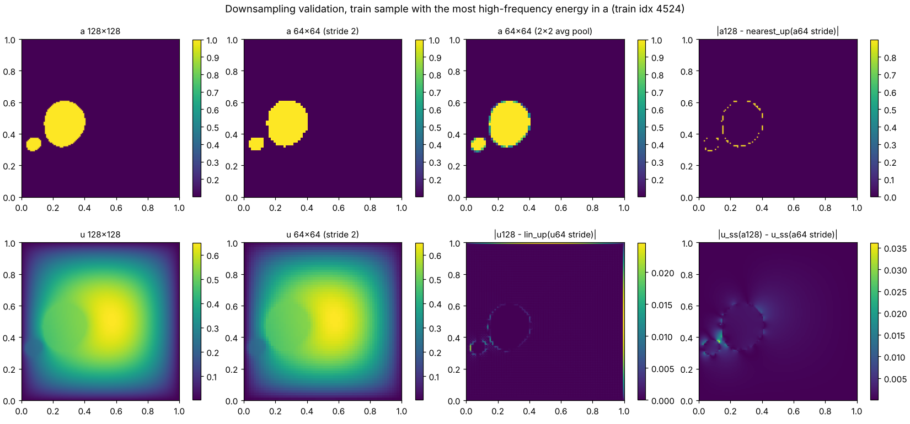

# Preprocessing

Pipeline (each step writes JSON-lines logs under `logs/` and a JSON report under `reports/`):

```
download_pdebench.py ─▶ inspect_dataset.py ─▶ preprocess.py ─▶ validate_downsampling.py ─▶ audit_data.py ─▶ verify_reference_solver.py
 (size + MD5 vs live     (structure, ranges,    (MD5 re-check,       (128→64 method,            (duplicates,       (operator, BC,
  DaRUS listing)          PDE residual,          group-aware splits,  coordinates, interior/     convergence,       convergence, MMS,
                          boundary models)       official-target      boundary errors;           test-split         storage separation,
                                                 split files,         TRAIN split only)          reference)         isolation)
                                                 train-only normalisers)
```

**Configuration:** `backend/configs/data.yaml`. **One-command reproduction:** `bash scripts/reproduce_m1.sh`. It runs
all six steps in order from `.venv` (Python 3.11), then the test suite with `PDEFLOW_REQUIRE_DATA=1`, so missing real
data fails instead of skipping. Run time is about 30 minutes on 4 vCPU, mostly the 1,000 exact solves.

## 1. Inputs and targets

| | Source | Model tensor |
|---|---|---|
| Input | `nu[i]`: permeability a ∈ {0.1, 1.0} | `(1, R, R)` float32, normalised |
| **Official target** (trained on; primary benchmark) | `tensor[i, 0]`, unmodified | `(1, R, R)` float32, normalised |
| Independent reference (secondary analysis) | CG steady state, test split only | not a model tensor; never loaded by the dataset class |

- **Positional channels:** none are added in preprocessing. neuraloperator's FNO adds its own grid embedding (§5).
- **β:** constant (1.0) in this file, so it is not a model input.

## 2. Resolution: 128 → 64 by stride-2 point subsampling

**Method:** `x[..., ::2, ::2]` (`pdeflow.data.resample.subsample`).
- This is identical to PDEBench's own `reduced_resolution: 2` (`pdebench/models/config/args/config_Darcy.yaml`).
- The values at kept points are **exactly** the 128² values: max |u₆₄ − u₁₂₈[::2, ::2]| = 0.0.

### 2.1 Exact sampling coordinates (`reports/downsampling_validation.json` → `coordinates`)

| Grid | Formula | first three | last three |
|---|---|---|---|
| 128² data (cell centres) | (2i+1)/256, i = 0…127 | 0.00390625, 0.01171875, 0.01953125 | 0.98046875, 0.98828125, 0.99609375 |
| **64² stride-2 (used)** | (4j+1)/256, j = 0…63 | 0.00390625, 0.01953125, 0.03515625 | 0.95703125, 0.97265625, 0.98828125 |
| 64² avg-pool centres (alternative) | (4j+2)/256 | 0.0078125, 0.0234375, 0.0390625 | 0.9609375, 0.9765625, 0.9921875 |
| neuralop embedding at 128 | i/128 | 0, 0.0078125, 0.015625 | 0.9765625, 0.984375, 0.9921875 |
| neuralop embedding at 64 | j/64 | 0, 0.015625, 0.03125 | 0.953125, 0.96875, 0.984375 |

- **Offset between true coordinate and embedding:** 1/256 at 128², **1/256 at stride-2 64²**, 2/256 at avg-pool 64².
  Stride-2 is therefore the only option where the FNO's positional embedding refers to the same physical location at
  both resolutions (`test_embedding_offset_consistent_for_stride_only`).
- **Asymmetry:** the stride-2 grid covers x ∈ [1/256, 253/256]. The last 128² row and column (x = 255/256) lie
  **outside** it, and the 128² embedding (up to 127/128) also extends beyond the largest 64² embedding (63/64).

### 2.2 Full-grid vs reduced-grid discrepancies: interior vs boundary

64 **training-split** samples. "Reconstruction" means interpolating the 64² field back to 128² with coordinate-aware
bilinear interpolation (constant extrapolation outside the coarse hull) and comparing with the 128² data.
"Information loss" means the rel-L2 between exact steady states solved at 128² for a₁₂₈ and for the 64²
representation of a.

| Metric (mean / median / p90 / max) | Interior: ≥ 2 fine cells from the edge, 15,376 cells | Boundary band: outer 2 fine cells, 1,008 cells | Last row + column only, 255 cells |
|---|---|---|---|
| Reconstruction rel-L2, **stride-2** | **0.19% / 0.17% / 0.28% / 0.34%** | 29.3% / 30.0% / 35.7% / 39.0% | 93.6% / 95.4% / 97.5% / 98.0% |
| Reconstruction max abs error, stride-2 | 0.0217 | 0.0585 | 0.0585 |
| Reconstruction rel-L2, avg-pool | 0.25% / 0.23% / 0.36% / 0.43% | 21.7% / 21.8% / 22.0% / 23.0% | 46.8% / 47.7% / 48.8% / 49.0% |
| Input cells misrepresented (stride-2) | 0.78% / 0.73% / 1.12% / 1.22% | 0.76% / 0.60% / 2.09% / 2.98% | 1.28% / 0.39% / 4.20% / 8.63% |
| **Information loss, stride-2** | **1.49% / 1.03% / 2.91% / 11.5%** | 6.74% / 4.04% / 15.5% / 46.0% | 10.3% / 5.09% / 27.1% / 64.7% |
| Information loss, avg-pool | 1.59% / 1.00% / 3.23% / 8.50% | 6.65% / 3.42% / 15.3% / 37.2% | 8.41% / 3.73% / 22.6% / 56.1% |

Whole-grid figures: reconstruction rel-L2 is 0.93% mean for stride-2 (0.21% excluding the last row/column) and 0.72%
for avg-pool. Information loss is 1.51% (stride-2) and 1.61% (avg-pool).

**Interpretation:**
1. **Training data is unaffected.** The model is trained on the 64² points, where stride-2 targets are exact.
   The boundary numbers describe *reconstruction* (a diagnostic) and the input-information floor, not errors in the
   training data.
2. **The boundary artefact is real and localised.** u is smallest near the walls (outer-ring median 0.012 against a
   0.128 median overall), so relative errors there are large even when absolute errors are small (≤ 0.059).
   The last row/column is pure extrapolation for stride-2.
3. **The interior is accurate.** Interior reconstruction error is about 0.2%, and interior information loss is about
   1.5% mean (1.0% median). That is the irreducible floor for any model that only sees a 64² input.
4. **The two methods are equivalent on information content** (interior 1.49% vs 1.59% mean). Stride-2 is chosen
   because:
   - it reproduces PDEBench's protocol;
   - it keeps inputs binary, the same distribution as 128² inputs;
   - it keeps targets exact;
   - it is the only option consistent with the FNO's positional embedding.

   Avg-pool reconstructs the edge better only because its coarse grid sits half a fine cell further outward. That
   benefits interpolation, not learning.



### 2.3 Spectral content (whole grid, 64 training samples, mean)

| | Energy above k = 32 (64² Nyquist) | Energy above k = 12 (FNO mode cut-off) |
|---|---|---|
| a | 0.61% | 1.82% |
| u | 9.5e-6 | 1.9e-4 |

u is very smooth. a is discontinuous, so its stride-2 samples alias about 0.6% of its energy.

## 3. Splits

- **Manifest:** `data/splits/darcy_beta1.0_seed20261111.json`, committed. It holds all indices, the seed, the source
  MD5 and the duplicate groups.
- **Seeded and group-aware:** one `numpy.random.default_rng(20261111).permutation` over groups of byte-identical
  inputs, then 80/10/10 → **8,000 / 1,000 / 1,000**.
- **Duplicate group:** the 46-member group (a ≡ 0.1) lands entirely in train, at positions 4,414–4,459. It is outside
  the 2,000-sample training prefix, so it is in **no** processed file (DATA.md §7).
- **Used:** train = first 2,000 of the shuffled train split; val = all 1,000; test = all 1,000. Raising `n_train`
  never changes val/test.
- **Changed from `PLAN.md`** (which had 2,500 samples split 2,000/250/250): larger, fixed evaluation sets give
  tighter estimates and a leakage-proof path to more training data.

## 4. Normalisation (train only)

- **Scalar Gaussian:** z = (x − μ)/σ, fitted on **train[:2000] at stride 2** only.
- **File:** `data/splits/normalizers_beta1.0_train2000_stride2.json`, committed.

| | μ | σ |
|---|---|---|
| a | 0.542480 | 0.449937 |
| u (official targets) | 0.160582 | 0.138295 |

- **Scalar, not per-point:** scalar statistics are resolution-independent, which 128² evaluation and arbitrary API
  inputs require.
- **No leakage, tested:** the stored statistics equal a fresh fit on the train prefix and differ from a fit on test.
- **No reference input:** the reference is never an input. Normalisers are computed by `preprocess.py` before the
  reference exists, and `test_reference_isolation.py` forbids any coupling.
- **Loss and metrics** will be computed on **decoded** (physical) u.

## 5. Architecture capability checks (no model trained yet)

- **Both resolutions:** neuraloperator's `FNO` accepts 64² and 128² inputs with the same parameters and returns
  same-shape outputs (`test_fno_resolution_support.py`).
  - `fft_norm="forward"` makes Fourier coefficients resolution-independent.
  - 12 modes is below the 64² Nyquist (32).
  - There is no domain padding by default; its effect will be measured.
- **Untrained, seeded FNO:** model(x₆₄) agrees with model(x₁₂₈)[::2, ::2] to 0.025% (smooth band-limited inputs) and
  0.045% (binary a), in mean rel-L2.
- **This is NOT evidence of generalisation.** It shows only that the untrained architecture handles both grids
  consistently. Whether a *trained* model transfers 64² → 128² is an empirical question, settled only by §6.

## 6. Evaluation plan for M2/M3 (fixed before training)

All metrics are relative L2 on decoded u, reported separately for each cell of this table:

| | Primary: vs **official PDEBench** targets | Secondary: vs independent **reference** |
|---|---|---|
| **64² (training resolution):** stride-2 test inputs → stride-2 official targets | headline benchmark number | analysis |
| **128² (zero-shot):** native 128² test inputs → native 128² official targets | reported separately; never averaged with 64² | analysis |

1. **Regions:** at 128², error is also reported for the interior (≥ 2 fine cells from the edge), the boundary band and
   the last row/column, because of §2.1–2.2. At 64², interior and boundary band are reported likewise.
2. **Strata:** errors are broken down by convergence of the official target, using PDE-residual bins (≤ 1e-3,
   1e-3–1e-2, 1e-2–1e-1, > 1e-1), and by fraction of a = 1.
3. **Model selection:** early stopping and checkpoint choice use **validation loss vs official targets at 64² only**.
   The test set and the reference are used once, after selection.
4. **Expected floors:** interior information loss of about 1–1.5% from 64² inputs, plus the official targets' own
   non-convergence (test mean deviation 2.9%, mostly in low-permeability samples). A primary error far below about
   1% at 64² would be suspicious and investigated.
5. **Baseline comparison for 128²:** the 64² prediction interpolated to 128² (coordinate-aware) is reported next to
   the FNO's native 128² prediction. Super-resolution is only claimed if the latter is better.
